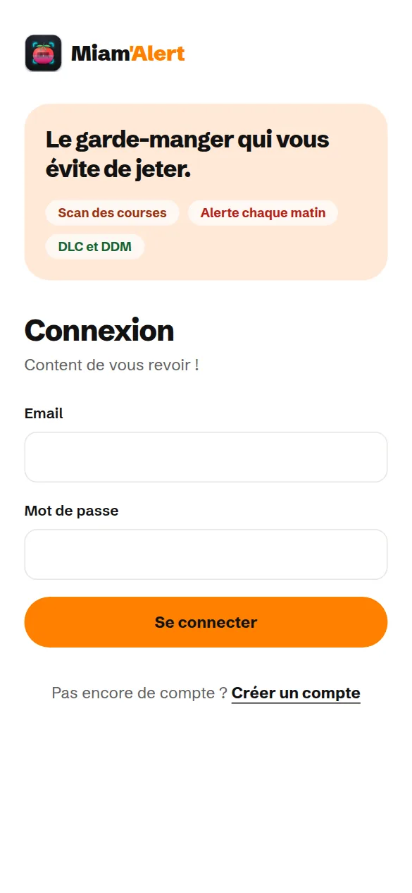
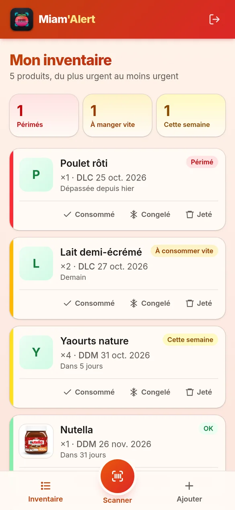

# Miam'Alert

**Garde-manger anti-gaspi.** On scanne ses courses, l'application suit les dates de péremption de tout le foyer, signale ce qu'il faut consommer en priorité et, à terme, suggère des recettes avec les produits les plus urgents.

Projet personnel conçu **security by design** : chaque fonctionnalité est pensée, codée et testée avec la sécurité en tête, en s'appuyant sur l'OWASP Top 10 et l'OWASP API Security Top 10.

> **Statut : application fonctionnelle de bout en bout (v0.2.0)** : API sécurisée et application web installable (PWA) avec scan du code-barres. Prochaines étapes : alertes quotidiennes et mise en ligne.
>
> Le développement se fait sur GitLab (CI/CD, merge requests) ; ce dépôt GitHub en est un miroir en lecture seule.

---

<p align="center">
  
  
  
</p>

## Fonctionnalités

- **Compte et session** : inscription, connexion, session renouvelée en arrière-plan, déconnexion réelle côté serveur.
- **Inventaire du foyer** : ajout, modification, suppression d'articles ; statut consommé / jeté / congelé.
- **Tri par urgence** : chaque article reçoit un niveau d'urgence calculé (périmé, à consommer sous 2 jours, cette semaine…), en distinguant la **DLC** (date limite, stricte) de la **DDM** (date de durabilité minimale, indicative).
- **Scan du code-barres** avec la caméra (ou saisie du code) : fiche produit (nom, marque, photo, Nutri-Score) récupérée sur [Open Food Facts](https://world.openfoodfacts.org) puis mise en cache ; il ne reste qu'à saisir la date, avec des raccourcis (+3 j, +1 sem, +1 mois).
- **Application installable** sur téléphone et ordinateur (PWA), pensée d'abord pour le mobile.

## Stack

| Couche | Choix |
|---|---|
| API | NestJS 12, TypeScript 6 (strict, ESM) |
| Base de données | PostgreSQL 16, Prisma 7 |
| Authentification | JWT (`@nestjs/jwt`), argon2id (`@node-rs/argon2`) |
| Tests | Vitest, Supertest |
| Environnement | Docker Compose (Node 24) |
| CI | GitLab CI |
| Front | React 19, Vite, TypeScript, Tailwind CSS 4, React Router, TanStack Query |
| Scan et PWA | `@zxing/browser`, `vite-plugin-pwa` (Workbox) |

## API

| Route | Accès | Rôle |
|---|---|---|
| `GET /health` | Public | État de l'API et de la base |
| `POST /auth/register` | Public, 10 req/min | Créer un compte et son foyer |
| `POST /auth/login` | Public, 10 req/min | Obtenir un access token (et le refresh token en cookie) |
| `POST /auth/refresh` | Cookie de session, 10 req/min | Renouveler les tokens |
| `POST /auth/logout` | Cookie de session, 10 req/min | Révoquer la session |
| `GET /me` | Connecté | Profil (prénom et nom facultatifs) et foyers |
| `PATCH /me` | Connecté | Modifier ou effacer son prénom et son nom |
| `POST /households/:householdId/pantry-items` | Membre du foyer | Ajouter un article |
| `GET /households/:householdId/pantry-items` | Membre du foyer | Lister l'inventaire, trié par urgence, paginé |
| `GET` / `PATCH` / `DELETE /pantry-items/:itemId` | Membre du foyer de l'article | Lire, modifier, supprimer un article |
| `GET /products/:barcode` | Connecté, 30 req/min | Fiche produit par code-barres EAN |

Toutes les routes exigent un access token, sauf celles marquées « Public ».

## Sécurité

### Authentification et sessions
- Mots de passe hachés avec **argon2id** aux paramètres recommandés par l'OWASP ; 12 caractères minimum plutôt que des règles de complexité (recommandations NIST et ANSSI).
- **Access token court** (JWT de 15 min, algorithme imposé à la vérification) gardé en mémoire par le client.
- **Refresh token** aléatoire (256 bits) dans un cookie `HttpOnly`, `Secure`, `SameSite=Strict`, limité au chemin `/auth`. Seule son empreinte SHA-256 est stockée en base.
- **Rotation** du refresh token à chaque usage ; la réutilisation d'un ancien token (signe de vol) révoque toute la session.
- Message d'erreur générique et **temps de réponse constant** à la connexion : impossible de savoir si un email a un compte.

### Contrôle d'accès
- **Refus par défaut** : un guard global exige un token sur toutes les routes ; les exceptions sont marquées explicitement (`@Public()`).
- **Protection contre les IDOR** : l'appartenance au foyer est vérifiée avant tout accès, ou directement intégrée à la requête SQL. L'article d'un autre foyer est introuvable (`404`, jamais `403`, pour ne pas confirmer son existence).
- Identifiants en **UUID**, l'utilisateur courant ne provient que du token vérifié.

### Entrées et sorties
- Validation stricte de toutes les entrées : champs inconnus rejetés (*mass assignment*), types, formats et longueurs bornés, `null` refusé là où il n'a pas de sens.
- Réponses construites explicitement : jamais d'entité brute, et le hash du mot de passe est exclu par défaut de toutes les requêtes.
- Pagination bornée, corps de requête limité à 16 ko, rate limiting global et renforcé sur les routes sensibles.
- Filtre d'exception global : aucune stack trace ni erreur interne renvoyée au client.
- En-têtes de sécurité (`helmet`), CORS limité à une liste blanche d'origines.

### Service externe (Open Food Facts)
- Code-barres validé (clé de contrôle EAN) **avant** tout appel.
- URL fixe construite proprement, redirections refusées (pas de SSRF), timeout de 5 s.
- Données reçues considérées comme **non fiables** : types vérifiés, longueurs bornées, caractères de contrôle retirés, images acceptées uniquement en HTTPS depuis le domaine d'Open Food Facts.
- En cas de panne : `503` sans détail, l'application reste utilisable en saisie manuelle.

### Données personnelles
- Minimisation (RGPD) : seuls l'email et le mot de passe sont obligatoires ; le prénom et le nom sont facultatifs, modifiables et effaçables à tout moment. Pas de téléphone ni de date de naissance, inutiles pour l'application.
- Les noms ne peuvent contenir que des lettres, espaces, apostrophes, traits d'union et points, et n'apparaissent jamais dans les logs.

### Journalisation
- Événements de sécurité en JSON (connexions, échecs, refresh, vol de session détecté, accès refusé à un foyer, rate limit).
- Les champs journalisables sont imposés par le typage : aucun email, mot de passe ni token ne peut y figurer, et un test le vérifie.

### Côté navigateur
- **Aucun token lisible par JavaScript** : l'access token reste en mémoire (jamais de `localStorage`), le refresh token est dans un cookie `HttpOnly`. Une faille XSS ne permettrait pas d'emporter la session.
- Un seul renouvellement de session à la fois, pour ne pas déclencher la détection de vol de token.
- Affichage des données externes (noms de produits) toujours échappé par React, jamais injecté en HTML.
- La PWA ne met en cache que les fichiers de l'application, **jamais les réponses de l'API** : rien ne reste lisible après une déconnexion, même sur un appareil partagé.
- Police et icônes hébergées avec l'application : aucune requête vers un tiers (pas de Google Fonts), donc aucune adresse IP transmise.
- Contrastes de couleurs vérifiés (WCAG AA), formulaires utilisables au clavier.

### Chaîne de développement
- Aucun secret dans le dépôt : configuration validée au démarrage, l'API refuse de démarrer si une variable manque ou si le secret JWT est trop court.
- Dépendances verrouillées, scripts d'installation npm bloqués sauf autorisation nominative.
- Conteneur exécuté en utilisateur non-root, base de données jamais exposée hors du réseau Docker.
- Branches protégées : tout passe par une merge request dont le pipeline doit être vert.

## Tests

- **Unitaires** : calcul de l'urgence, clé de contrôle EAN, nettoyage des données Open Food Facts, client HTTP (réseau simulé).
- **End-to-end** sur une vraie base PostgreSQL dédiée : authentification (token expiré, falsifié, `alg: none`, refresh réutilisé), validation, **tentatives d'accès aux données d'un autre foyer**, absence de données sensibles dans les logs.
- Aucun test ne dépend d'un service extérieur.
- Le parcours de l'application (connexion, inventaire, ajout, scan d'un code-barres filmé) a été vérifié dans Chrome avec une caméra simulée.

## Intégration continue

Chaque merge request déclenche un pipeline GitLab CI :

| Étape | Contenu |
|---|---|
| Qualité | API : lint, compilation TypeScript, build, tests unitaires ; front : lint, compilation, build |
| Tests | Tests e2e sur un PostgreSQL éphémère |
| Sécurité | `npm audit` de l'API et du front (échec si vulnérabilité haute), détection de secrets, analyse statique (SAST) |

## Lancer le projet

Prérequis : Docker et Docker Compose.

```bash
cp .env.example .env    # puis remplacer les valeurs factices (voir les commentaires du fichier)
docker compose up -d --build
docker compose exec backend npx prisma migrate deploy
```

- Application : http://localhost:5173
- API : http://localhost:3000
- Adminer (dev uniquement) : http://localhost:8080

Tests :

```bash
docker compose exec backend npm test            # unitaires
docker compose exec backend npm run test:e2e    # e2e (base miam_alert_test, créée automatiquement)
```

## Feuille de route

- [x] Socle de sécurité, authentification, inventaire, recherche de produits, CI
- [x] Application web PWA : connexion, inventaire, ajout, scan caméra, installation sur téléphone
- [ ] Alertes quotidiennes groupées par foyer
- [ ] Déploiement : image Docker de production non-root, HTTPS et HSTS derrière Nginx
- [ ] Recettes suggérées selon les produits les plus urgents
- [ ] Foyer partagé, statistiques de gaspillage, export et suppression des données (RGPD)

## Limites connues

Choix assumés, documentés plutôt que masqués :

- L'inscription répond `409` pour un email déjà utilisé, ce qui révèle l'existence d'un compte ; le risque est limité par le rate limiting, la parade complète (confirmation par email) est prévue.
- Un access token reste valable jusqu'à 15 minutes après une déconnexion (principe du JWT, d'où sa durée courte).
- Deux onglets qui renouvellent la session au même instant la font révoquer (détection stricte du vol de token) ; le front évitera les renouvellements simultanés.
- « Aujourd'hui » est calculé en UTC : entre minuit et 2 h en France, l'urgence peut être décalée d'un jour.
- Hors ligne, l'application s'ouvre mais demande de se connecter : les données de l'API ne sont volontairement pas mises en cache (voir « Côté navigateur »).
- Le scan par la caméra nécessite HTTPS (exigence des navigateurs) : sur téléphone, il fonctionnera une fois l'application en ligne.
