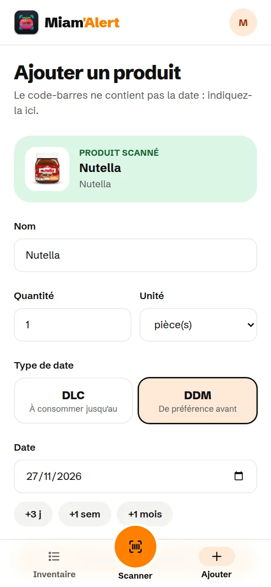

# Miam'Alert

**Garde-manger anti-gaspi.** On scanne ses courses, l'application suit les dates de péremption de tout le foyer, signale ce qu'il faut consommer en priorité et, à terme, suggère des recettes avec les produits les plus urgents.

Projet personnel conçu **security by design** : chaque fonctionnalité est pensée, codée et testée avec la sécurité en tête, en s'appuyant sur l'OWASP Top 10 et l'OWASP API Security Top 10.

> **Statut : en ligne sur [miam-alert.fr](https://miam-alert.fr) (v0.4.0)** : API sécurisée, application web installable (PWA) avec scan du code-barres, alerte quotidienne, suppression du compte et export des données (RGPD), sauvegardes chiffrées. Prochaines étapes : mot de passe oublié, déploiement continu, puis recettes.
>
> Le développement se fait sur GitLab (CI/CD, merge requests) ; ce dépôt GitHub en est un miroir en lecture seule.

---

<p align="center">
  
  
  
</p>

## Fonctionnalités

- **Compte et session** : inscription, connexion, session renouvelée en arrière-plan, déconnexion réelle côté serveur ; profil avec prénom et nom facultatifs.
- **Inventaire du foyer** : ajout, modification, suppression d'articles ; statut consommé / jeté / congelé.
- **Tri par urgence** : chaque article reçoit un niveau d'urgence calculé (périmé, à consommer sous 2 jours, cette semaine…), en distinguant la **DLC** (date limite, stricte) de la **DDM** (date de durabilité minimale, indicative).
- **Scan du code-barres** avec la caméra (ou saisie du code) : fiche produit (nom, marque, photo, Nutri-Score) récupérée sur [Open Food Facts](https://world.openfoodfacts.org) puis mise en cache ; la date est pré-remplie selon la catégorie du produit (yaourt, conserve, viande…) et reste modifiable, avec des raccourcis (+3 j, +1 sem, +1 mois).
- **Alerte du jour** : chaque matin à 9 h, une alerte unique par foyer résume les produits périmés et à consommer d'urgence (pas une notification par produit), affichée en bandeau sur l'inventaire.
- **Application installable** sur téléphone et ordinateur (PWA), pensée d'abord pour le mobile.

## Stack

| Couche | Choix |
|---|---|
| API | NestJS 12, TypeScript 6 (strict, ESM) |
| Base de données | PostgreSQL 16, Prisma 7 |
| Authentification | JWT (`@nestjs/jwt`), argon2id (`@node-rs/argon2`) |
| Tests | Vitest, Supertest |
| Tâches planifiées | `@nestjs/schedule` |
| Environnement | Docker Compose (Node 24) |
| CI | GitLab CI |
| Production | VPS dans l'UE, Docker Compose, Caddy (HTTPS Let's Encrypt), Nginx (front) |
| Front | React 19, Vite, TypeScript, Tailwind CSS 4, React Router, TanStack Query |
| Scan et PWA | `@zxing/browser`, `vite-plugin-pwa` (Workbox) |

## API

| Route | Accès | Rôle |
|---|---|---|
| `GET /health` | Public | État de l'API et de la base |
| `POST /auth/register` | Public, 10 req/min | Créer un compte et son foyer |
| `POST /auth/login` | Public, 10 req/min | Obtenir un access token (et le refresh token en cookie) |
| `POST /auth/refresh` | Cookie de session, 10 req/min | Renouveler les tokens |
| `POST /auth/logout` | Cookie de session, 10 req/min | Révoquer la session |
| `POST /auth/change-password` | Connecté + ancien mot de passe, 10 req/min | Changer son mot de passe (autres sessions révoquées) |
| `POST /auth/verify-email` | Public (jeton de l'email), 10 req/min | Confirmer son adresse email |
| `POST /auth/verify-email/resend` | Connecté, 10 req/min, 1 email/min | Renvoyer le lien de confirmation |
| `POST /auth/forgot-password` | Public, 10 req/min, 1 email/min par adresse | Recevoir un lien de réinitialisation (réponse identique que l'adresse ait un compte ou non) |
| `POST /auth/reset-password` | Public (jeton de l'email), 10 req/min | Choisir un nouveau mot de passe |
| `GET /me` | Connecté | Profil (prénom et nom facultatifs) et foyers |
| `PATCH /me` | Connecté | Modifier ou effacer son prénom et son nom |
| `GET /me/export` | Connecté, 5 req/min | Télécharger toutes ses données (JSON) |
| `DELETE /me` | Connecté + mot de passe, 10 req/min | Supprimer son compte et toutes ses données |
| `POST /households/:householdId/pantry-items` | Membre du foyer | Ajouter un article |
| `GET /households/:householdId/pantry-items` | Membre du foyer | Lister l'inventaire, trié par urgence, paginé |
| `GET` / `PATCH` / `DELETE /pantry-items/:itemId` | Membre du foyer de l'article | Lire, modifier, supprimer un article |
| `GET /products/:barcode` | Connecté, 30 req/min | Fiche produit par code-barres EAN |
| `GET /households/:householdId/alerts/today` | Membre du foyer | Alerte du jour du foyer (ou aucune) |
| `POST /alerts/:alertId/read` | Membre du foyer de l'alerte | Marquer l'alerte comme lue |

Toutes les routes exigent un access token, sauf celles marquées « Public ».

## Sécurité

Correspondance avec l'OWASP Top 10 et procédure de signalement d'une faille : voir [SECURITY.md](SECURITY.md).

### Authentification et sessions
- Mots de passe hachés avec **argon2id** aux paramètres recommandés par l'OWASP ; 12 caractères minimum plutôt que des règles de complexité (recommandations NIST et ANSSI).
- **Access token court** (JWT de 15 min, algorithme imposé à la vérification) gardé en mémoire par le client.
- **Refresh token** aléatoire (256 bits) dans un cookie `HttpOnly`, `Secure`, `SameSite=Strict`, limité au chemin `/auth`. Seule son empreinte SHA-256 est stockée en base.
- **Rotation** du refresh token à chaque usage ; la réutilisation d'un ancien token (signe de vol) révoque toute la session.
- **Vérification de l'adresse email** par un lien à usage unique, valable 24 h, dont seule l'empreinte est stockée ; jeton placé dans le fragment de l'URL (`#`), donc absent des journaux des serveurs ; renvoi limité à un email par minute.
- **Purge automatique** chaque nuit à 4 h, après la sauvegarde : sessions expirées depuis 30 jours, liens d'email utilisés ou expirés depuis 30 jours, alertes de plus de 90 jours. Le délai garde des traces pour enquêter sur un incident, et permet de reconnaître la réutilisation d'une ancienne session comme un vol.
- **Mot de passe oublié** : réponse identique et immédiate que l'adresse ait un compte ou non (pas d'énumération des comptes, ni par le contenu ni par le temps de réponse) ; lien à usage unique valable 30 min ; toutes les sessions révoquées après la réinitialisation. Les limites d'envoi (un email par minute) sont atomiques : un verrou en base empêche de les contourner par des requêtes simultanées (testé).
- **Changement de mot de passe** avec l'ancien mot de passe : toutes les sessions sont révoquées (un appareil perdu ou une session volée est déconnecté), une nouvelle est ouverte pour l'appareil courant.
- Message d'erreur générique et **temps de réponse constant** à la connexion : impossible de savoir si un email a un compte.

### Contrôle d'accès
- **Refus par défaut** : un guard global exige un token sur toutes les routes ; les exceptions sont marquées explicitement (`@Public()`).
- **Protection contre les IDOR** : l'appartenance au foyer est vérifiée avant tout accès, ou directement intégrée à la requête SQL. L'article d'un autre foyer est introuvable (`404`, jamais `403`, pour ne pas confirmer son existence).
- Identifiants en **UUID**, l'utilisateur courant ne provient que du token vérifié.

### Entrées et sorties
- Validation stricte de toutes les entrées : champs inconnus rejetés (*mass assignment*), types, formats et longueurs bornés, `null` refusé là où il n'a pas de sens.
- Réponses construites explicitement : jamais d'entité brute, et le hash du mot de passe est exclu par défaut de toutes les requêtes.
- Pagination bornée, corps de requête limité à 16 ko, rate limiting global et renforcé sur les routes sensibles.
- Filtre d'exception global : aucune stack trace ni erreur interne renvoyée au client.
- En-têtes de sécurité (`helmet`), CORS limité à une liste blanche d'origines.

### Service externe (Open Food Facts)
- Code-barres validé (clé de contrôle EAN) **avant** tout appel.
- URL fixe construite proprement, redirections refusées (pas de SSRF), timeout de 5 s.
- Données reçues considérées comme **non fiables** : types vérifiés, longueurs bornées, caractères de contrôle retirés, images acceptées uniquement en HTTPS depuis le domaine d'Open Food Facts.
- En cas de panne : `503` sans détail, l'application reste utilisable en saisie manuelle.

### Données personnelles
- **Export des données** (droit d'accès et portabilité) en un fichier JSON depuis le profil : champs choisis un par un, sans hash, empreinte de jeton ni identifiant interne, réponse `Cache-Control: no-store` ; testé contre la fuite des données d'un autre compte.
- **Suppression réelle du compte** depuis le profil, confirmée par le mot de passe (une session volée ne suffit pas) : compte, sessions, foyer, inventaire et alertes effacés en une transaction ; un foyer partagé est conservé pour ses autres membres. Testé, y compris l'absence de foyer orphelin.
- Minimisation (RGPD) : seuls l'email et le mot de passe sont obligatoires ; le prénom et le nom sont facultatifs, modifiables et effaçables à tout moment. Pas de téléphone ni de date de naissance, inutiles pour l'application.
- Les noms ne peuvent contenir que des lettres, espaces, apostrophes, traits d'union et points, et n'apparaissent jamais dans les logs.
- **Mentions légales et politique de confidentialité** consultables sans compte : données collectées, bases légales, durées de conservation, prestataires (dont la transmission de l'adresse IP à Open Food Facts lors de l'affichage des photos), droits et recours. Un seul cookie, strictement nécessaire : pas de bandeau de consentement.

### Supervision
- Logs de production en JSON (une ligne par événement), exploitables par un outil de supervision.
- Les tâches planifiées (alertes de 9 h, sauvegarde de 3 h) envoient un signal de vie à un service de surveillance : une tâche qui échoue ou ne tourne pas déclenche une alerte.

### Journalisation
- Événements de sécurité en JSON (connexions, échecs, refresh, vol de session détecté, accès refusé à un foyer, rate limit).
- Les champs journalisables sont imposés par le typage : aucun email, mot de passe ni token ne peut y figurer, et un test le vérifie.

### Côté navigateur
- **Aucun token lisible par JavaScript** : l'access token reste en mémoire (jamais de `localStorage`), le refresh token est dans un cookie `HttpOnly`. Une faille XSS ne permettrait pas d'emporter la session.
- Un seul renouvellement de session à la fois, pour ne pas déclencher la détection de vol de token.
- Affichage des données externes (noms de produits) toujours échappé par React, jamais injecté en HTML.
- La PWA ne met en cache que les fichiers de l'application, **jamais les réponses de l'API** : rien ne reste lisible après une déconnexion, même sur un appareil partagé.
- Police et icônes hébergées avec l'application : aucune requête vers un tiers (pas de Google Fonts), donc aucune adresse IP transmise.
- Contrastes de couleurs vérifiés (WCAG AA), formulaires utilisables au clavier.

### Mise en production
- **Images Docker de production** construites en plusieurs étapes : ni outils de compilation, ni dépendances de développement, ni gestionnaire de paquets dans l'image finale.
- **Aucun conteneur en root** (API, front, reverse proxy, base), système de fichiers en lecture seule, aucune capacité Linux, `no-new-privileges`.
- **Seul le reverse proxy est exposé** (ports 80 et 443) ; la base de données vit sur un réseau Docker interne sans accès à Internet.
- **HTTPS partout** : certificats Let's Encrypt renouvelés automatiquement, TLS 1.2 minimum, HSTS, enregistrement DNS **CAA** limitant l'émission de certificats à Let's Encrypt.
- **Front** : Content Security Policy stricte (aucun script en ligne ni domaine tiers, connexions limitées à l'API), `Permissions-Policy` (caméra seulement), protection contre le clickjacking.
- **Vraie IP du client** transmise par le proxy, sans possibilité de l'usurper (`X-Forwarded-For` falsifié ignoré, testé) : rate limiting et journaux restent fiables.
- **Moindre privilège pour les secrets** : générés sur le serveur, chaque conteneur ne reçoit que les siens (le front et le proxy ne voient jamais le secret JWT ni le mot de passe de la base).
- **Serveur durci** : connexion SSH par clé uniquement, root interdit, pare-feu, fail2ban, mises à jour de sécurité automatiques ; clé de déploiement GitLab en lecture seule.
- Migrations de la base appliquées avant le démarrage de l'API : le code ne tourne jamais sur un schéma qui ne lui correspond pas.

### Chaîne de développement
- Aucun secret dans le dépôt : configuration validée au démarrage, l'API refuse de démarrer si une variable manque ou si le secret JWT est trop court.
- Dépendances verrouillées, scripts d'installation npm bloqués sauf autorisation nominative.
- Conteneur exécuté en utilisateur non-root, base de données jamais exposée hors du réseau Docker.
- Branches protégées : tout passe par une merge request dont le pipeline doit être vert.

## Tests

- **Unitaires** (40) : calcul de l'urgence, contenu de l'alerte du jour, clé de contrôle EAN, nettoyage des données Open Food Facts, client HTTP (réseau simulé).
- **End-to-end** (125) sur une vraie base PostgreSQL dédiée : authentification (token expiré, falsifié, `alg: none`, refresh réutilisé), validation, **tentatives d'accès aux données d'un autre foyer**, génération idempotente des alertes, rate limiting derrière un proxy (IP usurpée), absence de données sensibles dans les logs.
- Aucun test ne dépend d'un service extérieur.
- Le parcours de l'application (connexion, inventaire, ajout, scan d'un code-barres filmé) a été vérifié dans Chrome avec une caméra simulée, puis avec les images de production derrière le reverse proxy en HTTPS.

## Intégration continue

Chaque merge request déclenche un pipeline GitLab CI :

| Étape | Contenu |
|---|---|
| Qualité | API : lint, compilation TypeScript, build, tests unitaires ; front : lint, compilation, build |
| Tests | Tests e2e sur un PostgreSQL éphémère |
| Sécurité | `npm audit` de l'API et du front (échec si vulnérabilité haute), détection de secrets, analyse statique (SAST) |

## Lancer le projet

Prérequis : Docker et Docker Compose.

```bash
cp .env.example .env    # puis remplacer les valeurs factices (voir les commentaires du fichier)
docker compose up -d --build
docker compose exec backend npx prisma migrate deploy
```

- Application : http://localhost:5173
- API : http://localhost:3000
- Adminer (dev uniquement) : http://localhost:8080

Tests :

```bash
docker compose exec backend npm test            # unitaires
docker compose exec backend npm run test:e2e    # e2e (base miam_alert_test, créée automatiquement)
```

### Production

Sur le serveur (Docker installé, enregistrements DNS `@`, `www` et `api` pointant vers lui) :

```bash
cp .env.prod.example .env.prod && chmod 600 .env.prod   # puis générer les secrets (voir le fichier)
sudo docker compose -f docker-compose.prod.yml --env-file .env.prod up -d --build
```

Caddy obtient les certificats HTTPS au premier démarrage ; les migrations sont appliquées avant le lancement de l'API.

## Feuille de route

- [x] Socle de sécurité, authentification, inventaire, recherche de produits, CI
- [x] Application web PWA : connexion, inventaire, ajout, scan caméra, installation sur téléphone
- [x] Alertes quotidiennes groupées par foyer
- [x] Mise en ligne : images Docker de production non-root, HTTPS et HSTS, serveur durci
- [x] Sauvegardes quotidiennes chiffrées et immuables, mentions légales, suppression du compte et export des données
- [x] Changement de mot de passe, vérification de l'email, mot de passe oublié
- [ ] Déploiement continu : images construites et analysées (Trivy) par la CI, puis déployées
- [ ] Recettes suggérées selon les produits les plus urgents
- [ ] Foyer partagé, statistiques de gaspillage

Toutes les évolutions envisagées, classées par priorité : [docs/EVOLUTIONS.md](docs/EVOLUTIONS.md).

## Limites connues

Choix assumés, documentés plutôt que masqués :

- L'inscription répond `409` pour un email déjà utilisé, ce qui révèle l'existence d'un compte ; le risque est limité par le rate limiting, la parade complète (confirmation par email) est prévue.
- Un access token reste valable jusqu'à 15 minutes après une déconnexion (principe du JWT, d'où sa durée courte).
- Deux onglets qui renouvellent la session au même instant la font révoquer (détection stricte du vol de token) ; le front évitera les renouvellements simultanés.
- « Aujourd'hui » est calculé en UTC : entre minuit et 2 h en France, l'urgence peut être décalée d'un jour.
- Hors ligne, l'application s'ouvre mais demande de se connecter : les données de l'API ne sont volontairement pas mises en cache (voir « Côté navigateur »).
- Déploiement encore manuel (construction des images sur le serveur) : l'automatisation par la CI est la prochaine étape.
- Les secrets de production sont passés aux conteneurs en variables d'environnement : lisibles par un administrateur du serveur (`docker inspect`). Les secrets Docker (fichiers) seraient un cran au-dessus.
- L'alerte du jour s'affiche dans l'application ; les notifications push viendront plus tard.
